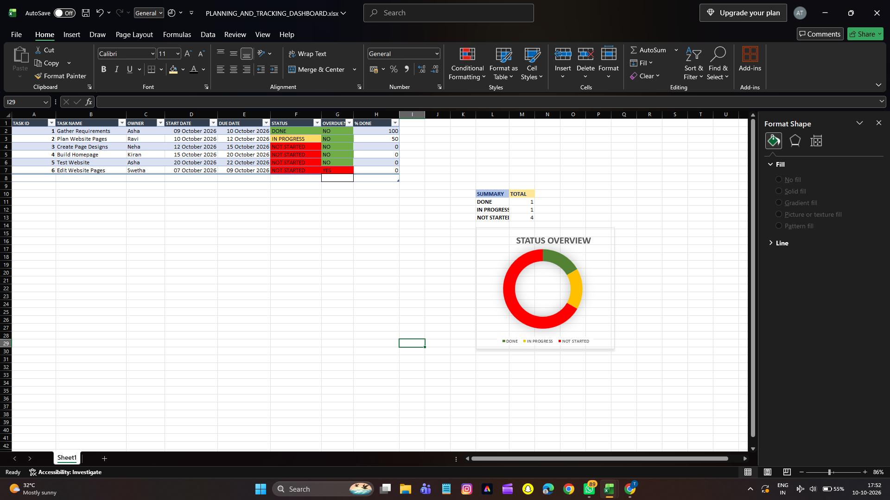

# Excel Planning & Tracking Dashboard

A dynamic Excel dashboard built to track project tasks, monitor overdue items, and visualize status - made for Excel 5 requirement.

### 📊 Dashboard Preview


### 🚀 Features
- Track 6 tasks with Owner, Start Date, Due Date, Status
- **Auto Overdue Flag:** Flags YES if Due Date < Today and not DONE
- **Progress %:** Auto calculates % completion
- **Summary Counts:** Dynamic counts of DONE / IN PROGRESS / NOT STARTED
- **Visual:** Donut chart with color-coded status (Green/Yellow/Red)
- Handles real Excel Table structure (fixes Text vs Date bug)

### 🧠 Formulas Used
```excel
// Overdue Logic (G2)
=IF(AND(E2<TODAY(),F2<>"DONE"),"YES","NO")

// Summary Counts (M11:M13)
=COUNTIF(F2:F7,"DONE")
=COUNTIF(F2:F7,"IN PROGRESS")
=COUNTIF(F2:F7,"NOT STARTED")

// % Done (H2)
=IF(F2="DONE",100,IF(F2="IN PROGRESS",50,0))
